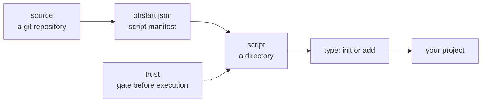

# {{ $frontmatter.title }}

ohstart has three basic concepts: **source**, **script** and **trust**. Everything else is a combination of them.

## How the three relate



- **Source**: a git repository with an `ohstart.json` at its root listing every script it provides.
- **Script**: a directory inside a source, carrying its own `script.json` that declares type and purpose.
- **Trust**: before any script from a source runs, ohstart confirms the source is trusted.

## Source

A source is an ordinary git repository. Its manifest is the `ohstart.json` at the repository root:

```json
{
  "name": "templates",
  "author": "your-name",
  "description": "Team templates and configuration",
  "scripts": {
    "sayhi": "sayhi",
    "lint/eslint": "lint/eslint"
  }
}
```

`scripts` maps **script names** to **directory paths**. Directories may be nested, so script names can be grouped with `/`, as in `lint/eslint`.

ohstart fetches the whole repository with `git clone --depth 1`, so any resource a script needs (templates, config fragments) only has to live inside the script directory.

## Script

A script is a directory containing three files:

```
sayhi/
  script.json     # script metadata
  index.ts        # entry code
  argv.ts         # argument definition
```

`script.json` declares:

```json
{
  "name": "sayhi",
  "type": "add",
  "description": "Write a hello.md"
}
```

- `name`: script name, which must match its key in `ohstart.json`.
- `type`: either `init` or `add`.
- `description`: one line shown by `ohstart list`.
- `entry`: entry file, `index.ts` by default.
- `argv`: argument definition file.

The entry file must default-export a function, which ohstart calls after bundling:

```ts
export default async function main() {
  // runs in the current project directory
}
```

## Two kinds of scripts

| Type   | Command        | Purpose                                   |
| ------ | -------------- | ----------------------------------------- |
| `init` | `ohstart init` | Initialize a project.                     |
| `add`  | `ohstart add`  | Install content into an existing project. |

The two cannot be mixed: running an `init` script through `ohstart add` fails with an error.

## Default source and addressing

The configuration may hold several sources, with exactly one marked as **default**. Script addresses come in two forms:

```bash
ohstart init vite/react              # vite/react in the default source
ohstart init @my-team/vite/react     # vite/react in a specific source
```

In `@<key>/<script>`, the key is the local key of the source, not the `name` declared inside it.

## Trust

Scripts execute code on your machine, so ohstart gates them:

- Source marked as **trusted**: runs directly.
- Not trusted: an interactive terminal is asked once, and the answer is recorded; non-interactive environments (scripts, CI) are refused, and `--trust` allows a single run.
- `--trust` applies to the current run only and is never written to the configuration.

See [Managing Sources](./sources.md) for details.

## Next steps

- [Managing Sources](./sources.md): adding sources, granting trust, switching the default.
- [Running Scripts](./scripts.md): how scripts run and how arguments are passed.
- [Script Contract](../script/contract.md): requirements when writing your own scripts.
