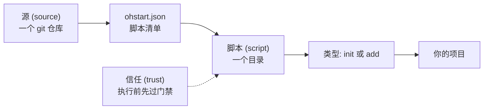

# {{ $frontmatter.title }}

ohstart 只有三个基本概念: **源**, **脚本**, **信任**. 其余内容都是这三个概念的组合.

## 三个概念的关系



- **源**: 一个 git 仓库, 仓库根有 `ohstart.json`, 列出该源提供的全部脚本.
- **脚本**: 源中的一个目录, 含自己的 `script.json`, 声明类型与用途.
- **信任**: 执行源中的脚本之前, ohstart 先确认该源是否可信.

## 源

一个源就是一个普通的 git 仓库. 仓库根的 `ohstart.json` 是它的清单:

```json
{
  "name": "templates",
  "author": "your-name",
  "description": "团队模板与配置",
  "scripts": {
    "sayhi": "sayhi",
    "lint/eslint": "lint/eslint"
  }
}
```

`scripts` 将**脚本名**映射到**目录路径**. 目录可以嵌套, 因此脚本名可以用 `/` 分级, 例如 `lint/eslint`.

ohstart 以 `git clone --depth 1` 拉取整个仓库, 因此脚本所需的资源文件 (模板, 配置片段) 放在脚本目录内即可随源一并获得.

## 脚本

一个脚本是一个目录, 包含三个文件:

```
sayhi/
  script.json     # 脚本元信息
  index.ts        # 入口代码
  argv.ts         # 参数定义
```

`script.json` 声明:

```json
{
  "name": "sayhi",
  "type": "add",
  "description": "写一个 hello.md"
}
```

- `name`: 脚本名, 须与 `ohstart.json` 中的键一致.
- `type`: 仅 `init` 或 `add` 两种.
- `description`: 一句话说明, `ohstart list` 会显示.
- `entry`: 入口文件, 默认 `index.ts`.
- `argv`: 参数定义文件.

入口文件必须默认导出一个函数, ohstart 打包后调用:

```ts
export default async function main() {
  // 在当前项目目录中执行
}
```

## 两类脚本

| 类型   | 命令           | 用途                |
| ------ | -------------- | ------------------- |
| `init` | `ohstart init` | 初始化项目.         |
| `add`  | `ohstart add`  | 为已有项目加装内容. |

两类不可混用: 脚本声明为 `init` 而使用 `ohstart add` 执行时会直接报错.

## 默认源与寻址

配置中可以有多个源, 其中被标记为**默认源**的只有一个. 脚本地址有两种写法:

```bash
ohstart init vite/react              # 默认源中的 vite/react
ohstart init @my-team/vite/react     # 指定源中的 vite/react
```

`@<键名>/<脚本名>` 中的键名是该源的本地键名, 不是源自身的 `name`.

## 信任

脚本会在本机执行代码, 因此 ohstart 设有门禁:

- 源被标记为**已信任**: 直接执行.
- 未信任: 交互式终端中询问一次, 同意后记录信任状态; 非交互环境 (脚本中, CI 中) 直接拒绝, 需放行时加 `--trust`.
- `--trust` 仅对本次执行生效, 不写入配置.

详见 [管理源](./sources.md).

## 下一步

- [管理源](./sources.md): 如何添加源, 给出信任, 切换默认源.
- [运行脚本](./scripts.md): 脚本如何运行, 参数如何传递.
- [脚本契约](../script/contract.md): 自行编写脚本时的契约要求.
